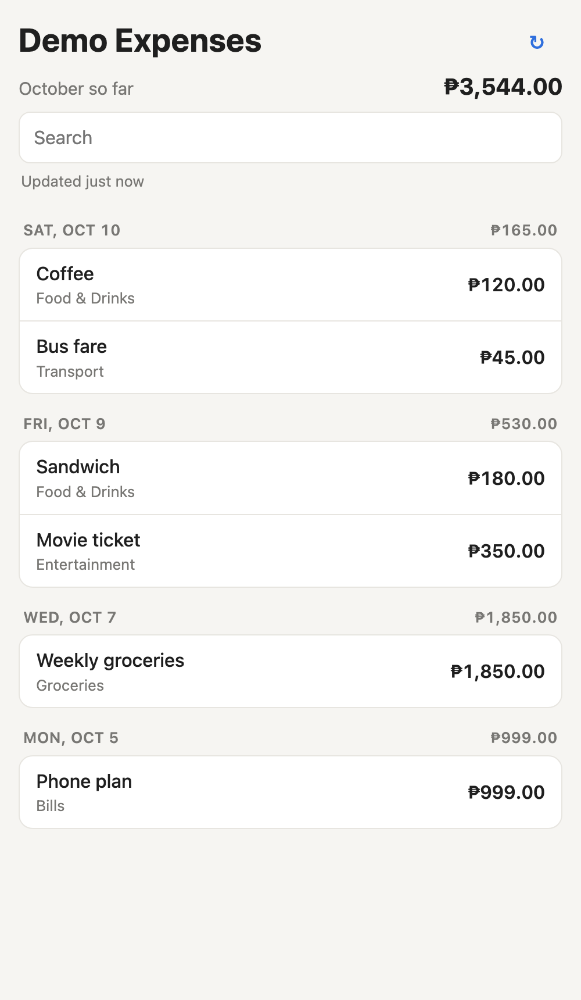

# Notion Expense Viewer

A fast, read-only iPhone view of my Notion expense tracker, installed as a home-screen web app.



*(Screenshot uses the built-in demo data.)*

## The problem it solves

I log every expense in a Notion database, but checking it on my phone means waiting for Notion's app to load
the whole editor just to answer "how much have I spent this month?" or "what did I buy on Tuesday?".

This app opens instantly, even offline, and shows only what I look at:

- **Month-to-date total** at the top
- **Expenses grouped by day**, each day with its own total
- **Name, category and amount** for every entry; tap one for its notes and an "Open in Notion" link
- **Search** across names, categories and notes

## How it works

```
iPhone (home-screen web app)  ⇄  Cloudflare Worker  ⇄  Notion API
  shows + caches the list        holds the Notion key     your database
```

- `public/` is the app: plain HTML, CSS and JS. A service worker caches the files so the app opens offline,
  and the last data is kept in local storage so it appears before the refresh finishes.
- `src/worker.js` serves those files and answers `/api/rows`. It checks an access key, fetches the 300 newest
  entries by Date from Notion, looks up linked category names, and returns plain JSON.
- The Notion token is stored as a Cloudflare secret and never reaches the phone.

## Setup

You need Node.js, a free Cloudflare account, and a Notion database with these columns:
`Name` (title), `Amount` (number), `Date` (date), `Category` (select or relation), `Notes` (text).
Different names? Edit `COL` at the top of `public/app.js` and `DATE_PROP` in `src/worker.js`.

### 1. Connect Notion

1. Create an internal integration at https://www.notion.so/my-integrations and copy its token.
   Under **Capabilities**, **Read content** is all it needs.
2. Open the database in Notion → `•••` → **Connections** → add the integration.
   If Category is a relation, share the categories database the same way.
3. Copy the database ID: the 32-character part of the database's URL before `?v=`.
   If you get "Could not find database", you probably copied the ID of the page around it.
   Open the database as a full page and copy again.

### 2. Run it locally

```bash
npm install
```

Create `.dev.vars` (it's gitignored):

```
NOTION_TOKEN=<integration token, or "demo" for sample data>
DATABASE_ID=<database ID>
APP_KEY=<any password>
```

```bash
npm run dev
```

Open http://localhost:8787 and enter your `APP_KEY`.

### 3. Deploy to Cloudflare

```bash
npx wrangler login
npx wrangler secret put NOTION_TOKEN
npx wrangler secret put DATABASE_ID
npx wrangler secret put APP_KEY
npm run deploy
```

The first `secret put` offers to create the Worker; answer yes. The first deploy asks you to pick a
`workers.dev` subdomain. The app is then at `https://notion-pwa.<subdomain>.workers.dev`.

### 4. Install on iPhone

1. Open the URL in **Safari**
2. **Share → Add to Home Screen**
3. Open it from the home screen and enter your `APP_KEY`

## Updating

Edit files, then run `npm run deploy`. The phone picks up the new version after one or two opens.
Use `npx wrangler tail` to watch live requests and errors.
